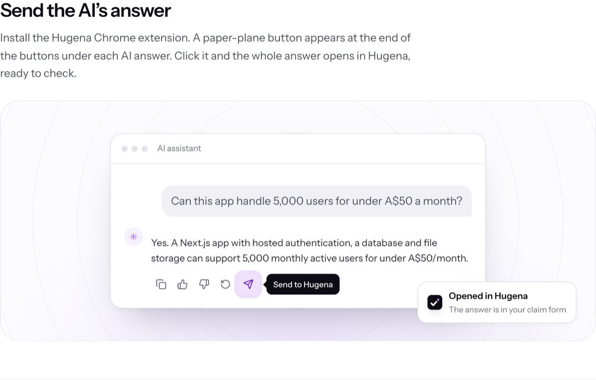
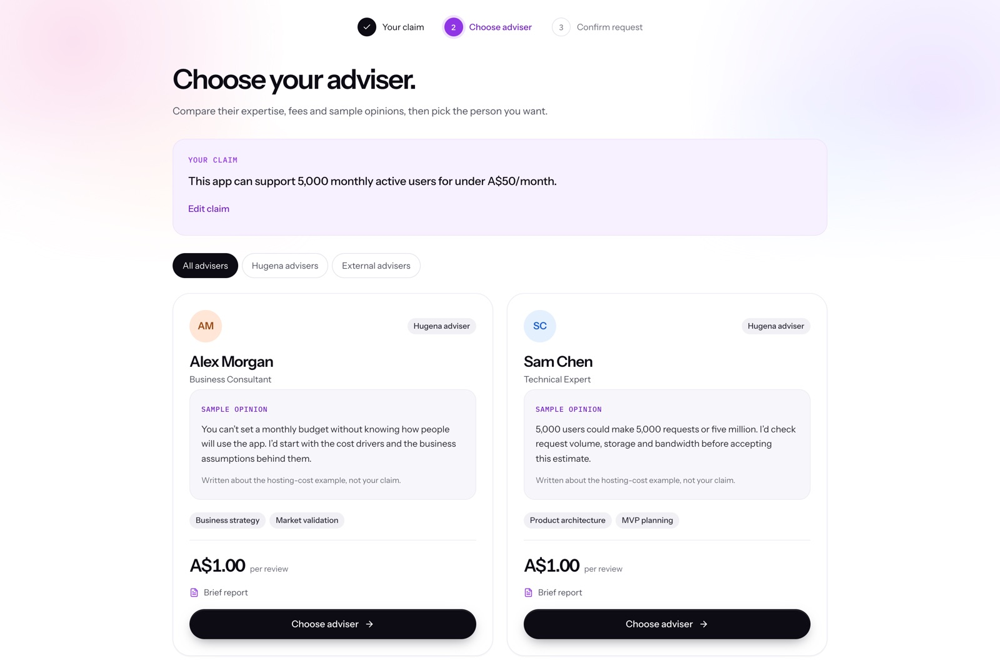
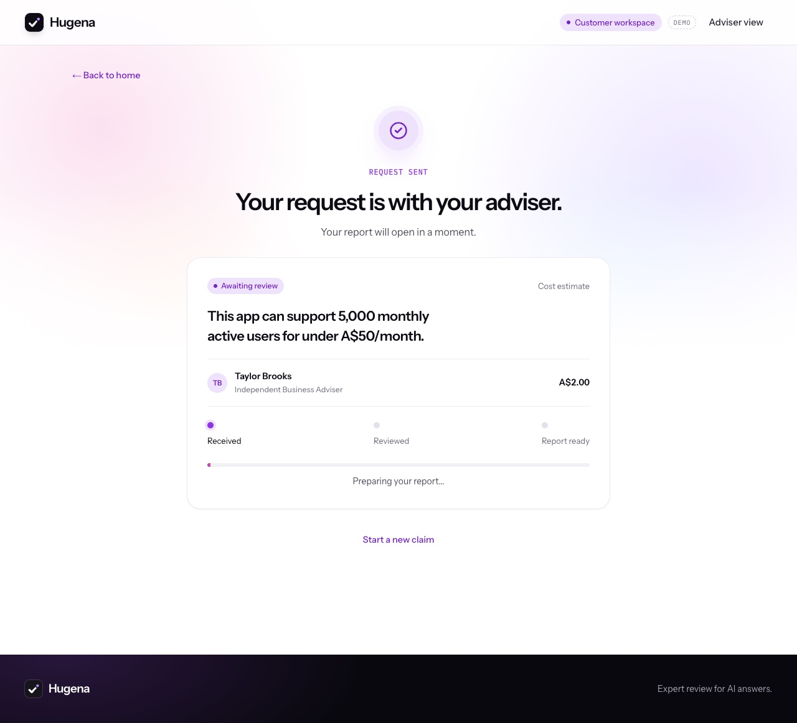
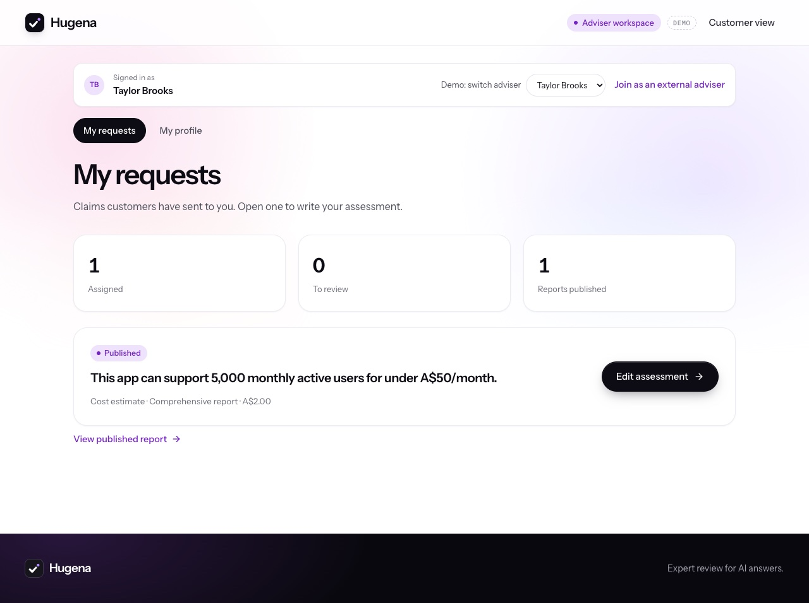
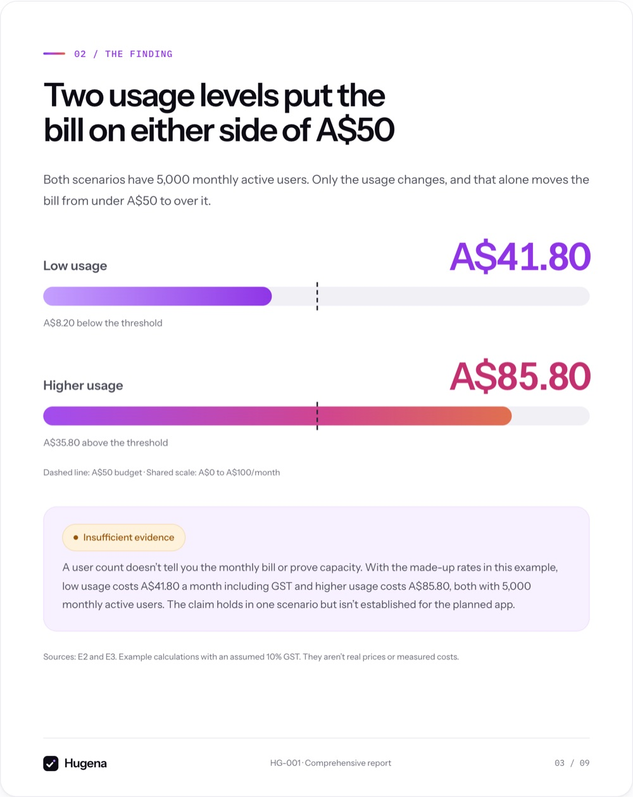
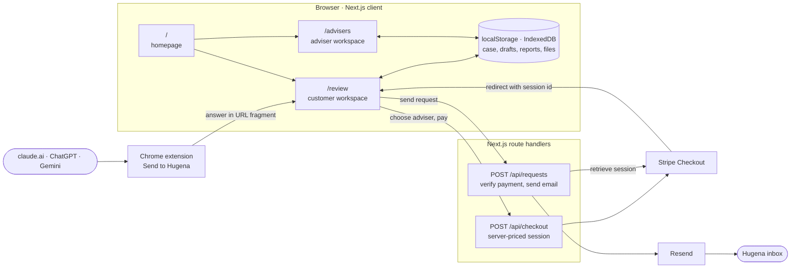
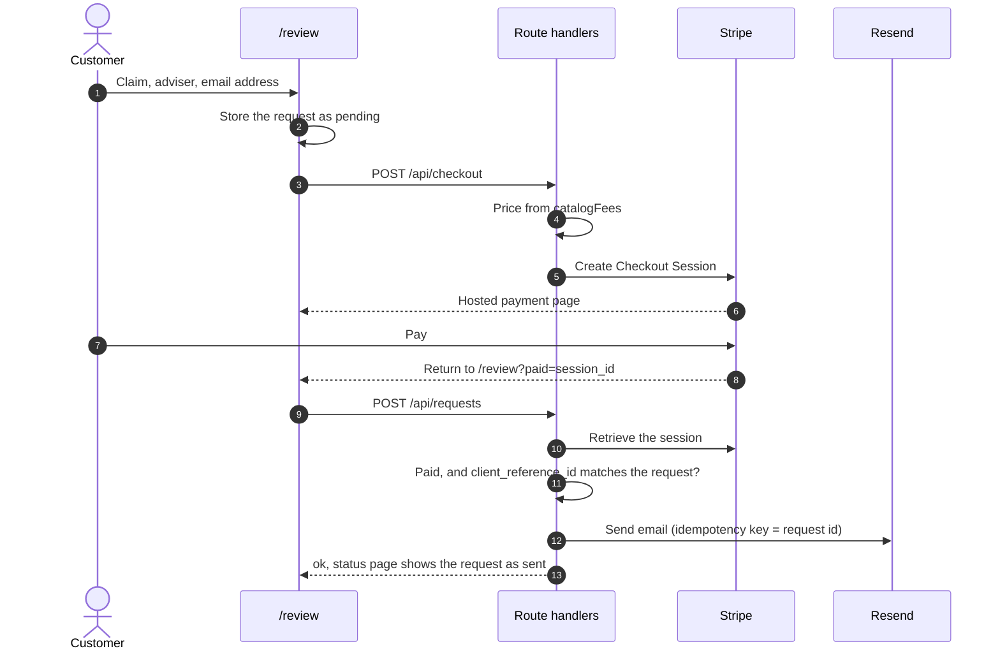

<h1 align="center">Hugena</h1>

<p align="center">
  <em>Expert review for AI answers: a person checks the claim before you act on it</em>
</p>

<p align="center">
  <a href="https://nextjs.org"></a>
  <a href="https://react.dev"></a>
  <a href="https://www.typescriptlang.org"></a>
  <a href="https://tailwindcss.com"></a>
  <a href="https://docs.stripe.com/payments/checkout"></a>
  <a href="https://resend.com"></a>
  <a href="https://vercel.com"></a>
  <a href="#testing"></a>
  <a href="#testing"></a>
</p>

<p align="center">
  <a href="#walkthrough">Walkthrough</a> •
  <a href="#architecture">Architecture</a> •
  <a href="#getting-started">Getting started</a> •
  <a href="#payments-and-request-emails">Payments</a> •
  <a href="#testing">Testing</a> •
  <a href="#deployment">Deployment</a> •
  <a href="#design-decisions">Design decisions</a> •
  <a href="#production-boundary">Production boundary</a>
</p>

---

Hugena lets someone send an AI answer they are about to rely on, such as a cost estimate, a plan or a timeline, to a human adviser they choose. The adviser checks the assumptions behind the claim and returns a verdict, the evidence, and a next step. A Chrome extension puts a **Send to Hugena** button under answers on claude.ai, ChatGPT and Gemini. Customers compare advisers by expertise, fee and sample opinion, then pay through **Stripe Checkout**. The request then reaches Hugena's inbox by email through **Resend**.

**Live:** [hugena.vercel.app](https://hugena.vercel.app)

<p align="center">
  
</p>

> [!IMPORTANT]
> **What is real and what is a demo.** Customer payment through Stripe Checkout (when enabled) and the request email to Hugena's inbox are real server-side integrations. Everything else runs in the browser: there are no accounts, the adviser "sign-in" is a demo switcher, and requests, assessments, published reports and adviser earnings live in `localStorage` and IndexedDB on one device. No adviser is contacted or paid by the app. See [Production boundary](#production-boundary).

---

## Highlights

- **Two workspaces, one flow.** `/review` is the customer side: share a claim, compare advisers, confirm, track status, read the report. `/advisers` is the adviser side: a queue of the requests sent to that adviser, a draft-then-publish assessment editor, a profile, and read-only earnings. A **Demo** switch in each lets one person present both sides.
- **Send from any AI chat.** A Manifest V3 extension adds a paper-plane button to the answer toolbar on claude.ai, chatgpt.com and gemini.google.com. The answer travels in the URL fragment, which browsers never send to a server, and Hugena clears it from the address bar after reading it.
- **Server-priced Stripe Checkout.** `/api/checkout` prices each session from the server's adviser catalogue, whatever the browser sends. `/api/requests` retrieves the session from Stripe and checks that it is paid and belongs to that request before anything is emailed.
- **One email per request.** The request id is the Resend idempotency key, and the browser remembers what it has sent, so a retry never sends a duplicate.
- **Fee-based reports.** An adviser's fee picks the report: under A$2 gets the brief report, A$2 or more gets the comprehensive report. Both render in the browser and download as print-ready A4 PDFs.
- **External advisers and commission.** Independent advisers create their own profile. Hugena keeps 10% of an external adviser's fee on a completed, paid case, calculated in integer cents so the split always adds back to the fee.
- **Tests at two levels.** 20 `node:test` unit tests cover pricing, commission, validation and the paid-session check. 24 Playwright tests cover both workflows, the extension, payments, emails, mobile layout at 390 px and automated WCAG A/AA checks.

## Walkthrough

The example claim (*"This app can support 5,000 monthly active users for under A$50/month"*) runs through the whole flow without payment, so the demo works on a fresh install.

| 1. Send the AI's answer | 2. Choose an adviser |
|---|---|
|  |  |
| **3. Track the request** | **4. The adviser's queue** |
|  |  |

<p align="center">
  
  <br>
  <sub><b>5. Read the report.</b> The finding page of the comprehensive report for the example claim. All rates in the example are invented for demonstration.</sub>
</p>

Sample PDFs: [brief report](public/samples/hugena-report-HG-001-brief.pdf) · [comprehensive report](public/samples/hugena-report-HG-001-comprehensive.pdf)

## Architecture



A paid request, step by step:



### Routes

| Route | Purpose |
|---|---|
| `/` | Product introduction, how it works, and separate entry points for customers and advisers |
| `/review` | Customer workspace. `?new=1` (the homepage buttons) starts a blank claim; plain `/review` reopens the current request |
| `/advisers` | Adviser workspace: **My requests** and **My profile**. `/reviewers` redirects here |
| `POST /api/checkout` | Creates a Stripe Checkout Session for one request |
| `POST /api/requests` | Confirms payment with Stripe, then emails the request through Resend |

The app keeps one request at a time. `app/workspace.tsx` renders both workspaces with a fixed mode that gates the customer and adviser UI, and only the adviser a request was sent to can open it or write its assessment. A draft assessment is stored separately from the published report and changes nothing for the customer until it is published.

## Tech stack

| Layer | Technology |
|---|---|
| Framework | [Next.js 16](https://nextjs.org) App Router, React 19, TypeScript 7 |
| Styling | Tailwind CSS 4, hand-written CSS, A4 print styles for the reports, Instrument Sans and IBM Plex Mono |
| Payments | [Stripe Checkout](https://docs.stripe.com/payments/checkout) through the REST API, with no SDK |
| Email | [Resend](https://resend.com) through the REST API |
| Client storage | `localStorage` for cases, drafts and profiles; IndexedDB for imported report files |
| Browser extension | Chrome Manifest V3, content script and options page |
| Testing | `node:test`, [Playwright](https://playwright.dev), [axe-core](https://github.com/dequelabs/axe-core) |
| Hosting | [Vercel](https://vercel.com) |

## Repository structure

```
.
├── app/
│   ├── page.tsx                  # / homepage
│   ├── review/page.tsx           # /review customer workspace
│   ├── advisers/page.tsx         # /advisers adviser workspace
│   ├── reviewers/page.tsx        # redirects /reviewers to /advisers
│   ├── workspace.tsx             # both workspaces, gated by mode
│   ├── adviser-directory.tsx     # adviser board, profile card, external sign-up, earnings
│   ├── how-it-works.tsx          # homepage steps that follow the scroll position
│   ├── report-files.tsx          # IndexedDB store for report files advisers import
│   ├── reports/                  # brief and comprehensive reports, print CSS
│   └── api/
│       ├── checkout/route.ts     # create a server-priced Stripe Checkout Session
│       └── requests/route.ts     # verify payment, email the request through Resend
├── data/
│   ├── advisers.ts               # adviser model, catalogue fees, commission, report format
│   ├── checkout.ts               # request parsing, session parameters, paid-session check
│   ├── notify.ts                 # request email validation and rendering
│   ├── payments.ts               # checkout mode, stored-payment validation
│   ├── import.ts                 # parses the extension's import payload
│   ├── sample-case.ts            # the HG-001 example claim, rates and scenarios
│   └── demo.json                 # listed adviser profiles
├── extension/                    # Chrome extension, see extension/README.md
├── public/samples/               # pre-rendered brief and comprehensive PDFs
├── scripts/export-sample-pdfs.mjs  # regenerates the sample PDFs from the live flow
├── tests/
│   ├── *.test.mjs                # node:test unit tests
│   └── browser/*.spec.ts         # Playwright browser tests
└── docs/images/                  # README screenshots
```

## Getting started

### Prerequisites

- Node.js 20.9 or later (the minimum for Next.js 16); the project targets Node.js 24
- npm
- Microsoft Edge for the Playwright suite (the config uses the `msedge` channel)

### Install and run

```sh
npm install
npm run dev
```

The repository has no lockfile, so use `npm install` rather than `npm ci`. Then open:

- [Homepage](http://localhost:3000/)
- [Customer workspace](http://localhost:3000/review)
- [Adviser workspace](http://localhost:3000/advisers)

For a production preview, the port the tests and PDF script expect:

```sh
npm run build
npm run start -- --port 3100
```

Without any environment variables the app runs as a self-contained demo: no payment step, and the email endpoint answers 503.

### Environment variables

| Variable | Where | Purpose |
|---|---|---|
| `NEXT_PUBLIC_STRIPE_CHECKOUT` | build | `live` or `test` shows "Pay … with Stripe" for the customer's own claims. Unset keeps the unpaid demo submission. The example claim never goes through Stripe |
| `STRIPE_SECRET_KEY` | server, secret | A restricted key with **Checkout Sessions: Write** |
| `STRIPE_MANAGED_PAYMENTS` | server | `true` lets Stripe act as merchant of record and handle tax |
| `STRIPE_AUTOMATIC_TAX` | server | `true` uses Stripe Tax instead (needs your GST registration in Stripe Tax) |
| `STRIPE_TAX_CODE` | server | Product tax code for the line item, for example `txcd_20030000` |
| `RESEND_API_KEY` | server, secret | Sends request emails |
| `HUGENA_NOTIFY_EMAIL` | server | Where requests go; currently `contact@coriva.tech`, the Resend account's own address |
| `HUGENA_NOTIFY_FROM` | server | Sender, default `Hugena <onboarding@resend.dev>` |

Put local values in `.env.local`, which Git ignores. `NEXT_PUBLIC_STRIPE_CHECKOUT` is built into the page, so changing it needs a new build.

## Usage

### The example claim

**Use the example** fills the form with the hosting-cost claim from `data/sample-case.ts`. It skips Stripe and email. After it is sent, the status page shows *"Your request is with your adviser."* for two seconds and then opens a prepared report. The adviser's fee decides which one (`reportFormat` in `data/advisers.ts`):

| Adviser | Fee | Report |
|---|---|---|
| Alex Morgan, Sam Chen, Jordan Ellis (Hugena advisers) | A$1.00 | Brief (`app/reports/brief-report.tsx`) |
| Taylor Brooks (external adviser) | A$2.00 | Comprehensive (`app/reports/comprehensive-report.tsx`) |

Both reports read their figures from `data/sample-case.ts`. Adviser sample opinions are written about this example, and the board says so. They are never presented as opinions on the customer's own claim.

### A claim of your own

Any other claim waits on the status page until its adviser publishes an assessment. Custom claims never receive an automatic or fabricated verdict. For these claims the confirm step asks for the email address the report should go to. It becomes the reply-to address on the request email and, with checkout on, the customer email in Stripe.

### The adviser side

In `/advisers`, pick the signed-in adviser with the demo switcher. **My requests** lists only the requests sent to that adviser. Writing an assessment shows which report the customer paid for and the adviser's earnings; payment status is read-only because it belongs to the payment system. An adviser can attach a PDF or Word report file of up to 10 MB, in which case only the verdict and key finding are required, and the customer's report page offers the file for download. Independent advisers join through **Join as an external adviser**.

### Chrome extension

Load `extension/` with `chrome://extensions` → **Developer mode** → **Load unpacked**. If Hugena is not on `localhost:3000`, change the address in the extension's options. [`extension/README.md`](extension/README.md) explains how the button finds answers on each site and how to keep the selectors current.

## Payments and request emails

### Stripe Checkout

- **Pricing is server-side.** Listed advisers (Alex, Sam, Jordan and Taylor) are charged their fee from `catalogFees` in `data/advisers.ts`, whatever the browser sends. Advisers who signed up in a browser exist only there, so their profile fee is used within Stripe's limits (A$0.50 to A$999,999.99) and the session metadata records `price_source: profile`.
- **Every payment can be matched.** The line item names the report and adviser, for example *"Hugena comprehensive report by Taylor Brooks"*. `client_reference_id` and metadata carry the request id, adviser and report.
- **The redirect is not trusted on its own.** Stripe returns the customer to `/review?paid={CHECKOUT_SESSION_ID}` or `/review?cancelled=1`. The request is stored as pending before checkout and only sent after the server confirms the session is paid and belongs to that request. With checkout on, unpaid requests are refused.
- **Managed Payments is always set explicitly.** Stripe accounts can turn it on by default, so each session states it. It and Stripe Tax are mutually exclusive.

Hugena currently runs with neither tax option: customers pay the adviser fee with no tax added, and the confirm step says so. If you turn either on, update that wording in `app/workspace.tsx`. Managed Payments only covers fully automated digital products, and Stripe's eligibility rules exclude professional services and anything with human intervention, which describes an adviser's review. Check with Stripe and your accountant before relying on it.

### Resend

- `onboarding@resend.dev` only delivers to the address that owns the Resend account. To send anywhere else, verify your domain in Resend and set `HUGENA_NOTIFY_FROM`, for example `Hugena <hugena@coriva.tech>`.
- If sending fails, the status page says so and offers a retry, which the idempotency key keeps from duplicating.
- Both endpoints reject malformed bodies and cross-site posts. Neither has a rate limit.

## Testing

```sh
npm run typecheck
npm run build
node --test tests/*.test.mjs
```

The unit tests (20, all passing) cover commission and rounding, profile validation, report format by fee, checkout request parsing, catalogue pricing, session parameters, the paid-session check, request email validation and HTML escaping, and the extension's import payload.

The browser suite has 24 tests in 6 files and runs against the production server on port 3100:

```sh
npm run build && npm run start -- --port 3100   # in one terminal
npx playwright test                             # in another
```

It covers the separate customer and adviser controls, advisers seeing only their own requests, submission, draft restoration, publication, report viewing, report file import, external-adviser onboarding, the extension's button placement, request emails and retries, endpoint input checks, mobile layout at 390 px, and automated WCAG A/AA checks on the entry pages and both reports. `tests/browser/payment.spec.ts` runs only when `NEXT_PUBLIC_STRIPE_CHECKOUT=test` is set for both `npm run build` and `npx playwright test`. It answers `/api/checkout` and Stripe's hosted page locally, so no real Checkout Session is created. Set `PLAYWRIGHT_BASE_URL` for another address. Automated accessibility checks are not a full accessibility certification.

### Regenerating the sample PDFs

With the production build running on port 3100:

```sh
node scripts/export-sample-pdfs.mjs
```

The script walks the customer flow once per report type, checks that no page content overlaps its footer, and writes `public/samples/hugena-report-HG-001-brief.pdf` and `-comprehensive.pdf`, with copies in `output/pdf/`. Set `PLAYWRIGHT_CHANNEL=chrome` if Edge isn't installed, and `SAMPLE_BASE_URL` for another port. Review the PDFs before shipping.

## Deployment

The project is deployed on Vercel as `hugena`:

```sh
npx vercel@latest login
npx vercel@latest link --yes --project hugena
printf '%s' 'live' | npx vercel@latest env add NEXT_PUBLIC_STRIPE_CHECKOUT production
printf '%s' '<restricted key>' | npx vercel@latest env add STRIPE_SECRET_KEY production --sensitive
printf '%s' 'contact@coriva.tech' | npx vercel@latest env add HUGENA_NOTIFY_EMAIL production
printf '%s' '<Resend API key>' | npx vercel@latest env add RESEND_API_KEY production --sensitive
npx vercel@latest deploy --prod --yes
```

`.vercelignore` keeps tests, the extension, docs and local artifacts out of the upload. Changing `NEXT_PUBLIC_STRIPE_CHECKOUT` needs a new deployment.

## Design decisions

- **The browser's price is never trusted.** Fees for listed advisers come from the server's catalogue. Only browser-created external profiles fall back to their own fee, bounded by Stripe's limits and labelled in the session metadata.
- **Payment is confirmed by Stripe.** A `?paid=` redirect proves nothing by itself. The server retrieves the session and checks the payment status and `client_reference_id` before forwarding the request.
- **Money in integer cents.** Fees, commission and payouts are integers. Commission rounds to the nearest cent, and the adviser's share is the fee minus that commission, so the parts always add back to the total.
- **The example is honest about being an example.** Sample opinions are labelled as written about the hosting-cost case, the example's rates are marked as invented, and custom claims wait for a real assessment.
- **Least data in transit.** The extension needs only the `storage` permission and reads nothing until clicked. The answer travels in the URL fragment, never in a request to a server.
- **Separate workspaces for each role.** Customers never see assessment editors, adviser creation or commission controls, and the customer flow ends in a read-only status page.

### Commercial model

Hugena supplies its standard advisers. External advisers pay 10% of their fee on a completed, paid case and keep 90%: an A$2 review gives A$0.20 to Hugena and A$1.80 to the adviser. This is not an extra charge to the customer, who sees one review price. The split appears only in the adviser tools.

## Production boundary

Hugena is a working product prototype, not a live marketplace.

- **Routes are not a security boundary.** They separate the two UIs. Any device can open either workspace.
- **No webhook yet.** A customer who pays and closes the tab before returning has paid without their request being emailed. The payment still shows in Stripe with the request id.
- **Demo data.** Adviser profiles, availability, assessments and earnings are demonstration data. Publication and payout happen only in the browser.
- **One device, one case.** The current case and draft live in `pitchproof-claims-v2` and external profiles in `pitchproof-external-advisers-v1`, both in `localStorage`. Starting another claim asks before replacing the current one. Storage failures show a notice.

Before a public launch this needs authenticated customer and adviser accounts, server-side ownership and permissions, a persistent multi-case database, real availability and messaging, verified adviser credentials, notifications, a Stripe webhook, and trusted payout and commission processing. Browser payment flags must never trigger real transfers.
